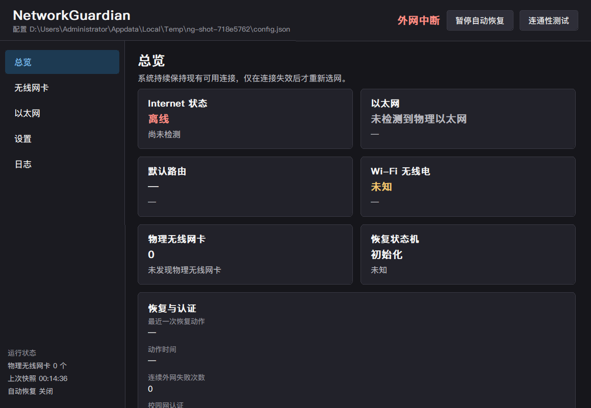
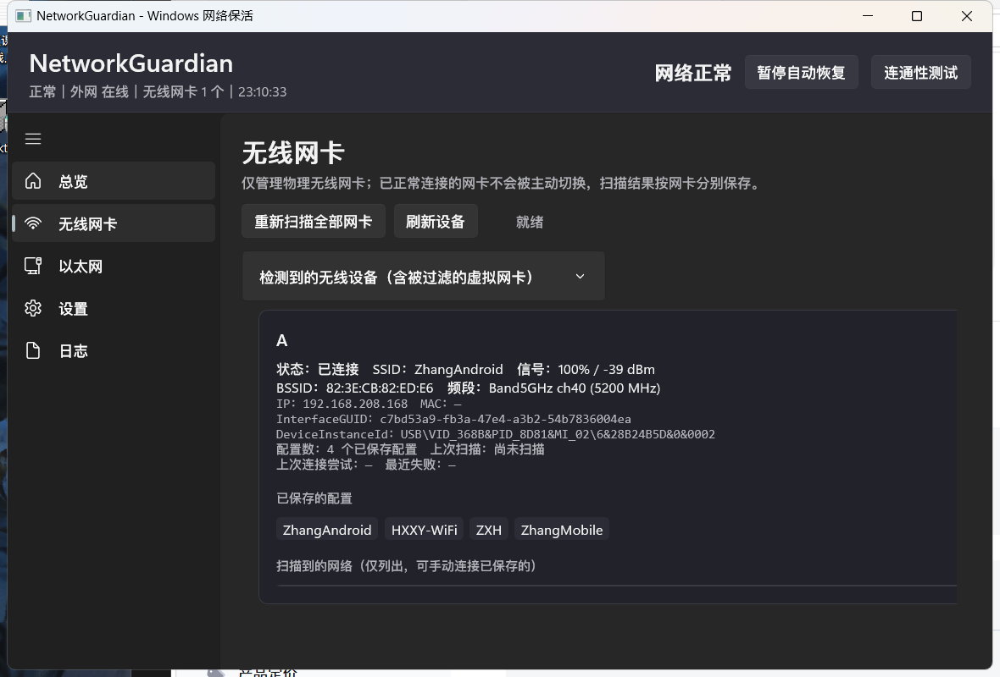

# NetworkGuardian

面向 Windows 10/11 x64 的本地网络管家：监测多块物理网卡的链路、路由和外网质量，在连接失效时执行恢复动作，并结合实测和个人偏好分配 Wi-Fi。

程序使用 C# / .NET 8，发布为 **Native AOT 单文件 EXE**，提权助手内置。目标电脑无需安装 .NET、Windows App SDK 或 Visual Studio；配置和学习数据保存在当前用户的数据目录。

[使用说明 PDF](docs/user-guide/NetworkGuardian-User-Guide.pdf) · [文档导航](docs/README.md) · [开发与发布](docs/development.md) · [维护与恢复](docs/maintenance.md) · [贡献说明](CONTRIBUTING.md)

## 当前交付

| 项目 | 0.14.0 发布验收结果 |
| --- | --- |
| 平台 | Windows 10 2004（build 19041）及以上，x64 |
| 交付 | 单个 `NetworkGuardian.exe`，原生 AOT，助手与种子模型内置 |
| EXE 大小 / 体积门禁 | 13.12 MiB / 13.5 MiB |
| 配置 Schema | v15；与应用版本分别维护 |
| 自动测试 | 389 项通过 |
| MCP 验收 | 官方 Python MCP 客户端 76 次隔离调用，另验证 Skill 标准库客户端 |
| 用户文档 | 13 页中文 PDF，附 LaTeX 源码 |

这些数字对应 [0.14.0 交付记录](docs/release-0.14.0.md)，不代表所有硬件和校园网环境均已验证。构建、测试和验收方法见 [开发文档](docs/development.md)。

## 主要功能

| 功能 | 行为 |
| --- | --- |
| 多网卡探测 | 分别检查物理以太网和 Wi-Fi 的链路、IP、路由与外网；链路 Up 不等于可以上网 |
| 质量评级与分配 | 结合丢包、TCP 失败、延迟、抖动和历史组合表现分配网络，不按 USB/内置网卡身份预设优劣 |
| SSID 指定网卡 | 普通网络和校园网都可绑定，只允许指定网卡连接；规则优先于评分和模型 |
| 保持禁用 | 物理有线/无线网卡的禁用规则跨重启保存；暂停自动恢复后仍会执行保持禁用 |
| 自动恢复 | 无线电、设备、认证命令、扫描、连接、DHCP 与复测；受限流、冷却和失败降权约束 |
| 出口管理 | 有线优先、接口 Metric、备用 Wi-Fi 去同源化；可选出口切换后处理旧 TCP 连接或重启旧网卡 |
| 网络凭据 | 开放网、个人网与 802.1X/EAP；密码通过当前 Windows 用户的 DPAPI 保护 |
| 概览报告 | 用中文解释质量、证据不足和建议；不把信号强度当作带宽或硬件诊断 |
| 偏好学习 | 60 道动态选择题，保存答题现场；神经网络和偏好模型有限参与评分 |
| 本机 MCP | 41 个工具覆盖查询、网卡、Wi-Fi、校园网、配置、凭据、学习和调试 |
| Agent 蒸馏 | 教师标注、后台训练、检查点续训、留出验证、部署和版本保护下的回滚 |

稳定连接通常会被保留；持续低质量时，优先验证替代连接，再释放原连接。实际动作还受硬绑定、保持禁用、测量充分度和恢复策略约束。

## 第一次使用

1. 获取构建出的 `NetworkGuardian.exe`，放到准备长期使用的位置。更新时先从托盘退出旧版本，再运行新版本。
2. 双击启动；默认可能最小化到托盘，从托盘打开窗口。
3. 在“网卡管理”核对设备，将不需要的网卡设为“保持禁用”。
4. 在“网络凭据”添加需要使用的网络，再到“无线网络”扫描、连接，按需指定 SSID 使用的网卡。
5. 到“自动管理”核对自动恢复、探测、质量学习及校园认证设置。设置会防抖自动保存，“保存并应用”可立即确认保存结果。
6. 回到“运行概览”查看质量评价和任务证据。首次使用需要积累采样，显示“待评估”不代表故障。

主程序通常以普通用户运行；启用、禁用、重启设备及管理员命令可能请求 Windows UAC。可选 Npcap 用于验证探测出口，未安装时仍可运行并降级。Windows 11 无法读取 SSID/BSSID/信号时，检查定位服务及桌面应用的位置权限。

| 侧栏分组 | 页面 |
| --- | --- |
| 总览 | 运行概览 |
| 网络管理 | 无线网络、有线网络、网卡管理、网络凭据 |
| 策略与诊断 | 自动管理、诊断日志 |

界面写操作需要确认；页面切换、只读查询、扫描和换题无需确认。MCP 写工具直接执行，Windows UAC 仍适用。

<details>
<summary>历史界面截图（当前分类和操作以使用说明为准）</summary>




</details>

## AI / MCP 与 Agent Skill

在“自动管理 → AI 工具接入 / MCP”开启服务器。默认关闭，默认固定端口 **18765**，可在设置中修改：

```text
http://127.0.0.1:18765/mcp
```

使用 Streamable HTTP，仅监听 IPv4 `127.0.0.1`，无鉴权；客户端须能访问运行软件的同一主机回环地址，远程或容器内的 `127.0.0.1` 通常不是该地址。工具参数和能力以 `tools/list` 为准，完整行为见 [MCP 文档](docs/mcp-server.md)。

将整个 [`skills/networkguardian`](skills/networkguardian/SKILL.md) 文件夹复制到 Agent 的技能目录；Codex 默认目录为 `~/.codex/skills/`。连接 MCP 后，可以直接提示：

> 使用 $networkguardian，持续蒸馏网络模型一小时，通过验证就部署，中断后继续已有任务。

Agent 自身可以充当教师，无须在 EXE 中保存模型服务密钥。独立接口 `model_distill` 支持创建、标注、后台训练、暂停、验证、部署、回滚和清理任务；`training_status`、`training_examples` 用于查询和取样。详见 [训练协议](skills/networkguardian/references/training.md)。

训练在软件后台执行，每 5 epochs 保存检查点；Agent 断线不取消训练，软件重启后可续训。Skill 能恢复任务，无法绕过 Agent 平台的会话或配额限制。训练对象是 8→8→1 网络效用模型；验证误差和任务置信度都不是实际联网成功概率。

## 数据和更新

默认数据目录：`%LOCALAPPDATA%\NetworkGuardian\`。主要内容包括：

| 文件 / 目录 | 内容 |
| --- | --- |
| `config.json`、`config.backup.json` | 设置、SSID 指定、保持禁用、MCP 开关及端口 |
| `wifi-networks.json` | Wi-Fi 凭据库；DPAPI 密文通常不能跨用户或电脑解密 |
| `network-history.json` | 质量历史、偏好与权威模型状态 |
| `network-brain.json` | 模型权重副本，不是独立恢复入口 |
| `network-survey.json` | 用户回答及网络上下文 |
| `distillation/` | 教师标签、基线、候选模型、进度、验证及回滚状态；按需创建 |
| `Logs/`、`helper/` | 滚动日志和临时提权通信 |

更新 EXE 会沿用该目录。备份或恢复前先退出软件，复制整个目录，避免只替换权重导致状态不一致。日志、配置和导出可能含网络名称、设备信息或用户填写的命令参数；共享前按实际排查需要选取。具体恢复流程见 [维护说明](docs/maintenance.md)。

## 从源码构建

在 Windows x64 上准备 .NET SDK（项目目标为 .NET 8）、PowerShell 7、VS Build Tools 的 C++ 工具链和 Windows SDK。具体命令在仓库根目录执行：

```powershell
dotnet build NetworkGuardian.sln -c Release --nologo
dotnet test tests/NetworkGuardian.Tests/NetworkGuardian.Tests.csproj -c Release --nologo
pwsh -NoProfile -File tools/build-portable.ps1
```

发布脚本会再次执行构建和测试，并检查零构建警告、单 EXE、无 PDB 和 13.5 MiB 体积门禁，输出 `release/NetworkGuardian.exe` 和 `release/发布说明.txt`。`-Zip` 额外生成版本化分发包；输出目录会被清空，不要指向源码或用户数据。

```powershell
pwsh -NoProfile -File tools/package-agent-skill.ps1 -OutputPath artifacts/NetworkGuardian-Skill.zip
pwsh -NoProfile -File tools/build-user-guide.ps1
```

PDF 重建需要可用的 XeLaTeX 及文档依赖；普通软件构建不需要 TeX。隔离验收、Python MCP 依赖、硬件测试边界和发布步骤见 [开发与发布](docs/development.md)。

## 命令行与故障定位

```powershell
.\NetworkGuardian.exe --visible
.\NetworkGuardian.exe --minimized
.\NetworkGuardian.exe --page devices
```

页面标识：`dashboard | wireless | ethernet | devices | credentials | settings | logs`。

找不到窗口先查看托盘；不能联网先区分链路、IP、默认出口和外网探测，再查“诊断日志”。VPN/TUN、代理或 ICMP 过滤可能影响探测，应结合按接口证据判断。恢复操作、凭据应用或训练任务“已受理”不等于执行成功。

- [故障排查与报告问题](docs/troubleshooting.md)
- [架构与关键约束](docs/architecture.md)
- [配置、数据恢复与长期维护](docs/maintenance.md)
- [质量采样与选网](docs/quality-preferences.md)、[中文评价报告](docs/quality-report.md)
- [问答与种子模型](docs/network-brain.md)、[MCP 和蒸馏接口](docs/mcp-server.md)
- [版本交付记录](docs/README.md#版本与历史)
